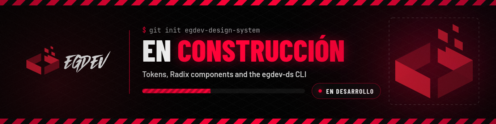

<!-- egdev:lang:start -->
<p align="right">
  <a href="./README.md"></a>
  
</p>
<!-- egdev:lang:end -->

<!-- egdev:header:start -->


<div align="center">

[](https://github.com/egdev6/egdev-design-system/stargazers)
[](https://github.com/egdev6/egdev-design-system/issues)
[](./LICENSE)

</div>
<!-- egdev:header:end -->

# egdev-design-system

EGDEV Foundation en código: el sistema de diseño que comparten egdev.es y todas las herramientas egdev (Mando, Cadencia, egdev-live, Criterio, media-tool y Quorb).

## Qué es

Un monorepo pnpm con seis paquetes: tokens de diseño, componentes React construidos sobre [Radix UI](https://www.radix-ui.com/), capas de efecto de la web, una descripción generada del sistema de diseño, un servidor MCP sin conexión sobre esa descripción y `egdev-ds`, la CLI que instala, actualiza y comprueba el sistema de diseño en una aplicación consumidora. Los productos lo reciben como tarballs locales versionados, sin registro.

- **Base:** React + Radix UI para el comportamiento, CSS con tokens para el aspecto.
- **Diseño:** se decide en Claude Design (artefacto *EGDEV Foundation*) y se traspasa aquí.
- **Metodología:** atomic design con primitivas, heredada de [Stack & Flow Design System](https://github.com/Stack-and-Flow/design-system).


| Paquete | Versión | Función |
|---|---|---|
| [`@egdev/tokens`](packages/tokens) | 0.5.1 | Tokens: fuente CSS única, salida CSS nativa y tema de Tailwind v4. |
| [`@egdev/ui`](packages/ui) | 0.3.2 | Componentes sobre Radix UI: primitivas, átomos, moléculas, organismos y plantillas. |
| [`@egdev/effects`](packages/effects) | 0.2.2 | Capas de efecto de la web (partículas, isotipo 3D) sobre canvas y three.js. |
| [`@egdev/system`](packages/system) | 0.4.2 | `design-system.json`, solo datos, que describe un conjunto exacto de tokens/ui/effects, más las CLI de `system.md` y de comprobación de artboards. |
| [`@egdev/mcp`](packages/mcp) | 0.4.2 | Servidor MCP sin conexión y de solo lectura sobre el artefacto de `@egdev/system`. |
| [`@egdev/cli`](packages/cli) | 0.1.1 | `egdev-ds`: instala, actualiza y comprueba el sistema de diseño en una aplicación consumidora. |

<!-- egdev:stack:start -->
## Stack

<div align="center">
<a href="https://github.com/Gentleman-Programming/gentle-ai">
  
</a>
</div>

<div align="center">


</div>
<!-- egdev:stack:end -->

## Inicio rápido

### Usarlo en una aplicación

Las aplicaciones instalan los seis paquetes como tarballs de una misma ejecución de `pnpm release:pack`, con `egdev-ds` (`@egdev/cli`). La guía completa, los requisitos (Node.js 24, pnpm o npm, Vite o Next.js) y una alternativa manual están en [docs/distribution/install.md](docs/distribution/install.md).

```bash
# In this repository: build the release set into release/ (tarballs + release.json)
pnpm release:pack

# First run, from a design system checkout:
node <ds-repo>/packages/cli/bin/egdev-ds.mjs init <project>

# Then, from the app (npx egdev-ds … or pnpm exec egdev-ds …):
egdev-ds upgrade <project> --dry-run    # plan plus the changelog of every package
egdev-ds upgrade <project>              # move the whole set to a newer release
egdev-ds upgrade <project> --add cli    # also vendor a package the app lacks
egdev-ds doctor <project>               # check the vendored install, CSS imports and MCP wiring
egdev-ds status <project> --json        # read-only report of the vendored state
```

El diseño aprobado de la CLI está en [docs/distribution/egdev-ds-cli.md](docs/distribution/egdev-ds-cli.md); la referencia de opciones, en [packages/cli/README.md](packages/cli/README.md).

### Trabajar en el sistema de diseño

Necesitáis Node.js 24 y pnpm 10.34.6 (`packageManager`).

```bash
pnpm install
pnpm tokens        # compile native CSS from the theme.css source
pnpm storybook     # http://127.0.0.1:6006
pnpm test          # full Vitest suite; at most two workers by default
pnpm typecheck
pnpm build
```

## Scripts

| Comando | Qué hace |
|---|---|
| `pnpm storybook` | Compila los tokens y arranca Storybook en el puerto 6006. |
| `pnpm test` | Ejecuta la suite de Vitest con dos workers. |
| `pnpm typecheck` | Comprueba los tipos de la raíz y de cada paquete. |
| `pnpm lint` | Ejecuta las comprobaciones de Biome (`pnpm format` aplica las correcciones). |
| `pnpm build` | Compila todos los paquetes. |
| `pnpm tokens` | Compila `tokens.css` desde `theme.css`. |
| `pnpm test:tokens` | Compila y comprueba fuente, alias y paridad. |
| `pnpm release:pack` | Compila el workspace y escribe los tarballs de la release y `release.json` en `release/`. |
| `pnpm test:cli` | Ejecuta los tests de `egdev-ds`. |
| `pnpm test:cli:consumer` | Ejecuta `egdev-ds` de extremo a extremo (npm + Vite, pnpm + Next.js). |
| `pnpm artifact` | Genera el artefacto del sistema de diseño de `@egdev/system`. |
| `pnpm system:docs` | Regenera `system.md`. |
| `pnpm props:check` | Valida el registro de nombres de props. |

`pnpm test` usa por defecto un presupuesto de dos workers, también cuando lo invoca el hook pre-push sin cambios. La selección de tests, las aserciones y los timeouts no cambian; los comandos de watch y coverage mantienen su comportamiento.

La CI (`.github/workflows/build-and-test.yml`) ejecuta dos jobs: **Verify** (lint, nombres de props, typecheck, build y tests unitarios, de CLI, de tokens y de paquetes) y **egdev-ds end to end**.

## Arquitectura

- [Arquitectura](docs/ARQUITECTURA.md): paquetes, niveles, Radix y estilos.
- [Material](docs/MATERIAL.md): superficies, borde de luz, sombras, pozos y overlays (Material v2).
- [Catalogación](docs/CATALOGACION.md): reutilizar, variante o componente nuevo, y en qué nivel.
- [Catálogo](docs/CATALOGO.md): cada componente de EGDEV Foundation con su nivel, paquete y base de Radix.
- [Decisiones](docs/DECISIONES.md): copia del registro de decisiones de EGDEV Foundation.
- [Plan de traspaso](docs/PLAN.md): el orden histórico de las fases.

## Contribuir

El trabajo planificado sigue ODD. El índice de roadmap activo es la issue [#491](https://github.com/egdev6/egdev-design-system/issues/491) (backlog de la web). Leed [CONTRIBUTING.md](CONTRIBUTING.md) antes de empezar.

Agentes: [AGENTS.md](AGENTS.md) resume las reglas; los flujos detallados están en [`skills/`](skills).

## Recursos

- [docs/MCP.md](docs/MCP.md): endpoint MCP de Storybook para agentes: arrancar el servidor de desarrollo, conectar un cliente y consultar las herramientas de documentación (en inglés).
- [Guía de instalación](docs/distribution/install.md): `egdev-ds` y la alternativa manual (en inglés).
- [Diseño de la CLI egdev-ds](docs/distribution/egdev-ds-cli.md): comandos, opciones, formato del plan y comprobaciones de doctor (en inglés).
- [Versionado](docs/distribution/versioning.md): versiones, reglas de incremento, changelogs y `release.json` (en inglés).
- [system.md](docs/distribution/system-md.md), [artefacto del sistema de diseño](docs/distribution/design-system-artifact.md) y [comprobación de artboards](docs/distribution/artboard-check.md) (en inglés).
- [Roadmap #491](https://github.com/egdev6/egdev-design-system/issues/491).

## Licencia

[MIT](./LICENSE). Los avisos de terceros están en [THIRD_PARTY_NOTICES.md](THIRD_PARTY_NOTICES.md).

<!-- egdev:contact:start -->
## Contacto

<div align="center">

[](https://egdev.es)
[](https://www.youtube.com/@egdev6)
[](https://twitch.tv/egdev6)
[](https://x.com/egdev66)
[](https://www.linkedin.com/in/egdev6/)
[](https://www.instagram.com/egdev6/)
[](https://github.com/egdev6)

[](mailto:egdev6@gmail.com)

</div>
<!-- egdev:contact:end -->

<!-- egdev:footer:start -->
---

<div align="center">

**⭐ Si este proyecto te resulta útil, considera darle una estrella en GitHub ⭐**

</div>
<!-- egdev:footer:end -->
