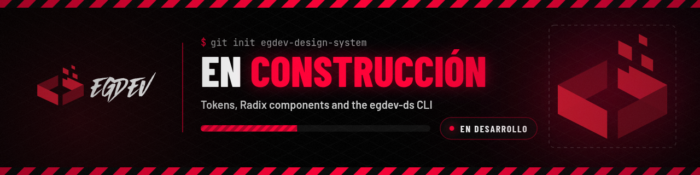

<!-- egdev:lang:start -->
<p align="right">
  
  <a href="./README.es.md"></a>
</p>
<!-- egdev:lang:end -->

<!-- egdev:header:start -->


<div align="center">

[](https://github.com/egdev6/egdev-design-system/stargazers)
[](https://github.com/egdev6/egdev-design-system/issues)
[](./LICENSE)

</div>
<!-- egdev:header:end -->

# egdev-design-system

EGDEV Foundation in code: the design system shared by egdev.es and every egdev tool (Mando, Cadencia, egdev-live, Criterio, media-tool and Quorb).

## What is it

A pnpm monorepo with six packages: design tokens, React components built on [Radix UI](https://www.radix-ui.com/), web effect layers, a generated design-system description, an offline MCP server over that description, and `egdev-ds`, the CLI that installs, upgrades and checks the design system in a consumer app. Products receive it as versioned local tarballs, without a registry.

- **Foundation:** React + Radix UI for behavior, token-backed CSS for appearance.
- **Design:** decided in Claude Design (the *EGDEV Foundation* artifact) and handed over here.
- **Methodology:** atomic design with primitives, inherited from the [Stack & Flow Design System](https://github.com/Stack-and-Flow/design-system).


| Package | Version | Role |
|---|---|---|
| [`@egdev/tokens`](packages/tokens) | 0.5.1 | Tokens: a single CSS source, native CSS output and a Tailwind v4 theme. |
| [`@egdev/ui`](packages/ui) | 0.3.2 | Components on Radix UI: primitives, atoms, molecules, organisms and templates. |
| [`@egdev/effects`](packages/effects) | 0.2.2 | Web effect layers (particles, 3D isotype) on canvas and three.js. |
| [`@egdev/system`](packages/system) | 0.4.2 | Data-only `design-system.json` describing an exact tokens/ui/effects set, plus the `system.md` and artboard check CLIs. |
| [`@egdev/mcp`](packages/mcp) | 0.4.2 | Offline, read-only MCP server over the `@egdev/system` artifact. |
| [`@egdev/cli`](packages/cli) | 0.1.1 | `egdev-ds`: installs, upgrades and checks the design system in a consumer app. |

<!-- egdev:stack:start -->
## Stack

<div align="center">
<a href="https://github.com/Gentleman-Programming/gentle-ai">
  
</a>
</div>

<div align="center">


</div>
<!-- egdev:stack:end -->

## Quick start

### Use it in an app

Apps install the six packages as tarballs from one `pnpm release:pack` run, using `egdev-ds` (`@egdev/cli`). The full guide, prerequisites (Node.js 24, pnpm or npm, Vite or Next.js) and a manual fallback are in [docs/distribution/install.md](docs/distribution/install.md).

```bash
# In this repository: build the release set into release/ (tarballs + release.json)
pnpm release:pack

# First run, from a design system checkout:
node <ds-repo>/packages/cli/bin/egdev-ds.mjs init <project>

# Then, from the app (npx egdev-ds … or pnpm exec egdev-ds …):
egdev-ds upgrade <project> --dry-run    # plan plus the changelog of every package
egdev-ds upgrade <project>              # move the whole set to a newer release
egdev-ds upgrade <project> --add cli    # also vendor a package the app lacks
egdev-ds doctor <project>               # check the vendored install, CSS imports and MCP wiring
egdev-ds status <project> --json        # read-only report of the vendored state
```

The approved CLI design is [docs/distribution/egdev-ds-cli.md](docs/distribution/egdev-ds-cli.md); the flag reference is [packages/cli/README.md](packages/cli/README.md).

### Work on the design system

Requires Node.js 24 and pnpm 10.34.6 (`packageManager`).

```bash
pnpm install
pnpm tokens        # compile native CSS from the theme.css source
pnpm storybook     # http://127.0.0.1:6006
pnpm test          # full Vitest suite; at most two workers by default
pnpm typecheck
pnpm build
```

## Scripts

| Command | What it does |
|---|---|
| `pnpm storybook` | Compiles tokens and starts Storybook on port 6006. |
| `pnpm test` | Runs the Vitest suite with two workers. |
| `pnpm typecheck` | Type-checks the root and every package. |
| `pnpm lint` | Runs Biome checks (`pnpm format` applies fixes). |
| `pnpm build` | Builds every package. |
| `pnpm tokens` | Compiles `tokens.css` from `theme.css`. |
| `pnpm test:tokens` | Compiles and checks the source, aliases and parity. |
| `pnpm release:pack` | Builds the workspace and writes the release tarballs and `release.json` to `release/`. |
| `pnpm test:cli` | Runs the `egdev-ds` tests. |
| `pnpm test:cli:consumer` | Runs `egdev-ds` end to end (npm + Vite, pnpm + Next.js). |
| `pnpm artifact` | Builds the `@egdev/system` design-system artifact. |
| `pnpm system:docs` | Regenerates `system.md`. |
| `pnpm props:check` | Validates the prop naming registry. |

`pnpm test` uses a two-worker default budget, including when the unchanged pre-push hook invokes it. Test selection, assertions and timeouts are unchanged; watch and coverage commands retain their existing behavior.

CI (`.github/workflows/build-and-test.yml`) runs two jobs: **Verify** (lint, prop naming, typecheck, build, unit, CLI, token and package tests) and **egdev-ds end to end**.

## Architecture

- [Architecture](docs/ARQUITECTURA.md) (Spanish): packages, levels, Radix and styles.
- [Material](docs/MATERIAL.md) (Spanish): surfaces, light edge, shadows, wells and overlays (Material v2).
- [Cataloging](docs/CATALOGACION.md) (Spanish): reuse, variant or new component, and at which level.
- [Catalog](docs/CATALOGO.md) (Spanish): every EGDEV Foundation component with its level, package and Radix base.
- [Decisions](docs/DECISIONES.md) (Spanish): copy of the EGDEV Foundation decision log.
- [Handover plan](docs/PLAN.md) (Spanish): the historical phase order.

## Contributing

Planned work follows ODD. The active roadmap index is issue [#491](https://github.com/egdev6/egdev-design-system/issues/491) (website backlog). Read [CONTRIBUTING.md](CONTRIBUTING.md) before starting.

Agents: [AGENTS.md](AGENTS.md) summarizes the rules; the detailed flows live in [`skills/`](skills).

## Resources

- [docs/MCP.md](docs/MCP.md): Storybook MCP endpoint for agents: start the dev server, connect a client and query the documentation tools.
- [Install guide](docs/distribution/install.md): `egdev-ds` and the manual fallback.
- [egdev-ds CLI design](docs/distribution/egdev-ds-cli.md): commands, flags, plan format and doctor checks.
- [Versioning](docs/distribution/versioning.md): versions, bump rules, changelogs and `release.json`.
- [Consumer requests](docs/distribution/consumer-requests.md): how consumer apps request DS changes, mitigate meanwhile and try unreleased changes locally.
- [system.md](docs/distribution/system-md.md), [design-system artifact](docs/distribution/design-system-artifact.md) and [artboard check](docs/distribution/artboard-check.md).
- [Roadmap #491](https://github.com/egdev6/egdev-design-system/issues/491).

## License

[MIT](./LICENSE). Third-party notices are in [THIRD_PARTY_NOTICES.md](THIRD_PARTY_NOTICES.md).

<!-- egdev:contact:start -->
## Contact

<div align="center">

[](https://egdev.es)
[](https://www.youtube.com/@egdev6)
[](https://twitch.tv/egdev6)
[](https://x.com/egdev66)
[](https://www.linkedin.com/in/egdev6/)
[](https://www.instagram.com/egdev6/)
[](https://github.com/egdev6)

[](mailto:egdev6@gmail.com)

</div>
<!-- egdev:contact:end -->

<!-- egdev:footer:start -->
---

<div align="center">

**⭐ If you find this project useful, consider giving it a star on GitHub ⭐**

</div>
<!-- egdev:footer:end -->
