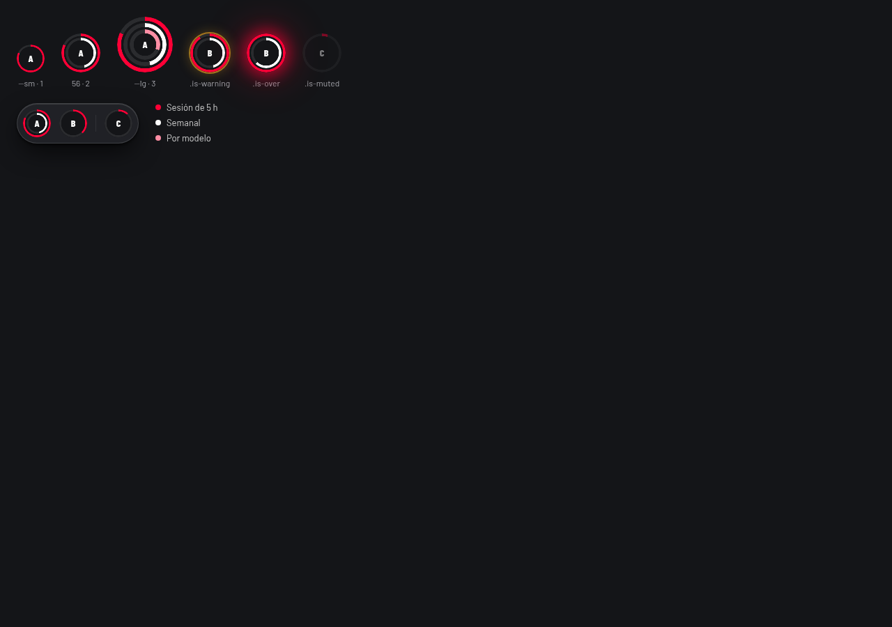

# Component contract — Gauge

- **Version / status:** v0.8 — **Approved** (unchanged component contract). The separate [implementation plan](../components/gauge/v0.8/implementation-plan.md) is **Approved for local implementation**, including its two prerequisites; see the [plan approval record](../components/gauge/v0.8/plan-approval.json). Current implementation status: **PARTIAL — LOCAL IMPLEMENTATION VERIFIED, PACKED CONSUMER MATRIX BLOCKED**; see the [verification report](../components/gauge/v0.8/verification/report.md). This is not full completion.
- **Approval / recovery:** **COMPONENT_CONTRACT_ONLY** describes the [manual contract approval receipt](../components/gauge/v0.8/approval.json), not the separate plan authorization. The explicit user response “si” approved the complete presented v0.8 with its details, payload digest and scoped visuals; a subsequent explicit “si” approved the separately recorded local implementation plan. These are manual observed records, not cryptographically signed/provider-issued receipts, GitHub comments or memory-only evidence. A future agent unable to recover the source explicit approvals must STOP and request confirmation; the records are not self-authorizing trust. See also [canonical capture metadata](../components/gauge/v0.3/capture.json).
- **Snapshot identity:** `version: 0.8`; `contentSHA256: f0999610927cc8556259c3896365697f4447ebae69eff810f3a2b66b57a3210d`; `visualHashes`: VIS-01 `3e12c98b6b46341576117dc8694a4ec207310a2eff9d619d2920b8efd1f2774b`, VIS-02 `b54ba9681dd14899ab8b303cba3bfbc64ed937cefe314fc342d5007108ba2c80`; `approvalReference: ../components/gauge/v0.8/approval.json` (observed user “si”, complete v0.8 contract only); `canonicalIssue: https://github.com/egdev6/egdev-design-system/issues/30`; `latestPublishedComment: Pending` (no subsequent snapshot comment known).
- **Hash definition:** SHA-256 of UTF-8 payload from the heading line `## 1. Purpose and scope` through EOF, LF line endings including the final newline; tracking metadata above that heading is excluded, never hashed into itself.
- **Frozen approved snapshot:** original payload review/proposal wording, acceptance-table Pending entries, closure checklist and next-step text are retained byte-for-byte as the presented snapshot. Their historical planning status is superseded only by this tracking header and the linked verification report, not rewritten in the payload. Contract and plan approvals remain separate; no payload hash refresh, version bump or inferred approval is used.
- **Approved API defaults / details:** `valueText` defaults to normalized decimal `"X / 100"`; `state` defaults to `normal`; `center` defaults to absent. No ref, `asChild` or Gauge events; documented native semantic protections, accessible-name/description wiring, inherited attributes, layout-only `className` precedence and named-export/type shape are accepted, not open decisions. All previously scoped product, accessibility, numeric validation/fallback, unavailable wording, CSS geometry, visual-table and Material well decisions remain accepted as part of the whole contract.
- **Visual scope / evidence:** VIS-01 remains approved only for single-ring anatomy, proportions and optional-center placement, excluding the fixed A and caption. VIS-02 is observed context only. Unchanged v0.3 source images remain the expected references; v0.8 implementation captures are observed evidence, not replacement targets. The report records the scoped 40px comparison, eight-story/browser and local automated results with limits: Default-only accessibility scan, CSS-zoom simulation, screen reader **Not evaluated**, and external packed React 18/19 consumption **Blocked**. No pixel-equality or arbitrary-tolerance claim is made.
- **Destination / authorization:** [issue #30](https://github.com/egdev6/egdev-design-system/issues/30), within [#7](https://github.com/egdev6/egdev-design-system/issues/7), remains at v0.4 per supplied context, not a fresh remote check; local v0.5/v0.6/v0.7 were unpublished and v0.8 is **not published**. Any subsequent snapshot publication requires a separately authorized **comment on #30**, not a body edit or new issue. GitHub-visible asset publication/access is still **Pending**, an independent external publishing gate, not fabricated approval.
- **Remaining gates / limits:** the offline packed-consumer matrix remains blocked at dependency installation; no further fixture attempt or network fallback is authorized by this evidence unit. Screen-reader validation is Not evaluated. GitHub asset publication/access and snapshot-comment authorization remain independently Pending; no issue update, upload, commit or push is claimed. The approved local plan does not authorize dependency/token changes or a broad Surface/IconButton/Tabs migration. All 13 global conventions remain `proposed` with `approval: null`; eight Gauge usages are `existing` observations bound to the actual `packages/ui/src/atoms/gauge/types.ts` hash, not global convention promotion. Servers used for the recorded observations have been stopped; this documentation unit starts none.

## 1. Purpose and scope

- **Approved product boundary:** one non-interactive circular ring representing any bounded magnitude normalized to 0–100; optional center icon, value or short text, never a fixed logo. Consumer chooses `normal`, `warning`, `critical` or `muted`; no automatic thresholds.
- **Non-goals:** task progress, indeterminate/loading behavior, actions, tooltips, legends, toolbar/dock, domain rules, or two/three independent rings. The multi-ring molecule belongs to [issue #31](https://github.com/egdev6/egdev-design-system/issues/31), not a dependency required to implement this atom; #31 may consume it.
- **Cataloging:** new public React atom in `@egdev/ui`, proposed directory `packages/ui/src/atoms/gauge/`. Preserve the existing `eg-gauge` public marker. This follows the approved single-concept boundary, not the provisional catalog's multi-ring/Progress suggestion.
- **Inspected evidence:** prior spec inspection (retained, not rerun in this docs-only revision): `packages/ui/src/index.ts` exports the Surface, IconButton and Tabs barrels and `cn`, but no Gauge export; `packages/ui/package.json` exposes the package root and `styles.css`. Legacy Gauge CSS exists in `packages/ui/src/styles/legacy/bundle.css:1698–1719`; it does not establish a public React API. No CodeGraph query is claimed for this revision.
- **Alternatives:** Surface supplies Material, not numeric meter semantics; IconButton adds forbidden actions; Tabs coordinates selection. None can be reused or varied into this responsibility. Composing them does not supply a ring; the inspected package root exposes none to extract. Retain compatible visual intent from the original preview, not its 0–1 input, `role="img"`, clicks or multi-ring behavior.

## 2. Anatomy and composition

| Part | Responsibility | Native element / primitive | Allowed content |
| --- | --- | --- | --- |
| Root | Own numeric semantics, size and `data-state` | `div`; `role="meter"` only for finite values | Internal parts; no arbitrary children |
| CSS ring (track and fill) | One circle and its normalized magnitude | Decorative `span`, `aria-hidden="true"`, non-focusable; proposed markup, not implementation | Original conic-gradient arc with radial-mask hollow center; zero and full circumference supported |
| Center | Optional visual supplement | Decorative, non-focusable wrapper | `ReactNode`: non-interactive icon, numeric value or short text |
| State cue | Non-color indication and description | Visible text plus decorative status icon | `stateText`; required outside normal state |
| Unavailable content | Readable fallback without fake measurement | Plain text inside the root, no meter role | Required label plus unavailable message |

- **Radix:** none proposed: Radix Progress conveys task completion, not an arbitrary magnitude. Passive ARIA meter semantics are approved; no interactive behavior is reimplemented. No dependency addition is authorized. No `asChild`, ref forwarding or public subcomponents are proposed; those unmentioned API restrictions are not approved by the accessibility block.
- **Markers / composition:** keep `eg-gauge`; no new public part-selector API is proposed. Internal CSS-ring/center/cue classes are composed with `cn()`. Use `useId()` for description relationships, never styling or fixed shared IDs. Hosts provide any surrounding card with Surface; no toolbar is embedded. The decorative span is an anatomy proposal for the approved CSS geometry approach, not runtime code or exact markup approval.

## 3. Public API

Proposed type shape (documentation only): v0.6 own-prop names are maintained and approved for Gauge, not globally. Required naming/passive semantics, non-normal text/icon cues, finite-positive numeric diameter with invalid-size fallback to md (56px), no artificial cap, and customizable unavailableText default are approved. The native/ref exclusions and other unmentioned API details below remain proposals; this is not whole-API approval.

```ts
type GaugeState = 'normal' | 'warning' | 'critical' | 'muted';
type GaugeSize = 'sm' | 'md' | 'lg';
type GaugeStateProps =
  | { state?: 'normal'; stateText?: string }
  | { state: Exclude<GaugeState, 'normal'>; stateText: string };
type GaugeNativeProps = Omit<ComponentPropsWithoutRef<'div'>,
  | 'children' | 'role' | 'aria-valuemin' | 'aria-valuemax' | 'aria-valuenow'
  | 'aria-valuetext' | 'aria-label' | 'aria-labelledby' | 'aria-hidden'
  | 'aria-live' | 'aria-disabled' | 'tabIndex' | 'accessKey' | 'contentEditable'
  | 'dangerouslySetInnerHTML' | 'onClick' | 'onChange' | 'defaultValue'>;
type GaugeProps = GaugeNativeProps & GaugeStateProps & {
  label: string;
  value: number;
  valueText?: string;
  center?: ReactNode;
  /** Preset or finite positive CSS-pixel diameter, including fractions; invalid numbers use md (56px), no artificial maximum. */
  size?: GaugeSize | number;
  /** Customizable unavailable-data message. @default 'Data unavailable' */
  unavailableText?: string;
};
```

| Prop / event | Type | Required | Default / rule and approval scope | Description |
| --- | --- | --- | --- | --- |
| `label` | `string` | Yes | Required non-empty accessible name approved; no default | Meaning of this magnitude; sole-source aria-label mapping remains the proposed API detail |
| `value` | `number` | Yes | No default; finite clamp to [0, 100] approved | Proposed API/ARIA mapping uses the same normalized number as geometry |
| `valueText` | `string` | No | `"X / 100"`, X = normalized decimal — proposed default | Contextual equivalent, e.g. `"42 of 100 capacity units"`; never incoherent with clamping |
| `state` | `GaugeState` | No | `normal` — proposed default | Consumer owns interpretation; no automatic thresholds |
| `stateText` | `string` | Required for non-normal via `GaugeStateProps` | Consumer-supplied visible text plus icon requirement approved; no automatic state text | Visible, described non-color condition cue |
| `center` | `ReactNode` | No | Absent — proposed default | Decorative supplement; equivalent meaning must be in label/valueText |
| `size` | `GaugeSize \| number` | No | Approved `md` (56px); invalid numeric input falls back to md (56px) | Presets: `sm` 40px, `md` 56px, `lg` 80px; any finite positive CSS-pixel ring diameter, including fractions (e.g. 64.5); 0, negatives, NaN and ±Infinity fall back to 56px; no artificial maximum; not caption height |
| `unavailableText` | `string` | No | `"Data unavailable"` — approved, customizable | Readable fallback for non-finite value; consumer supplies meaningful non-empty custom text |
| `className` | inherited `string` | No | Absent — proposed | Proposed root outer layout only; no internal appearance override contract |
| Native attributes | `GaugeNativeProps` | No | Proposed forwarding to root with semantic restrictions | Proposed `id`, `title`, `data-*` and compatible `aria-*`; merge external `aria-describedby` with internal cue IDs |
| Gauge events | Not applicable | — | None — proposed public API detail | No value-change, activation or selection notifications proposed; passive/no-action behavior is already approved |

### Prop convention mapping

Use the [canonical source](../../skills/_shared/prop-naming.json), [generated reference](../prop-naming.md) and [shared lookup/review workflow](../../skills/_shared/component-contract.md#prop-naming-registry), not a component-local copy of the global matrix. Meaning/name/alias lookup reuses `value` → `primary-value`, `size` → `preset-dimensions`, `label` → `accessible-name`; Gauge proposals map `state` → `consumer-selected-condition`, `stateText` → `condition-description`, `valueText` → `measurement-text-equivalent`, `center` → `decorative-center-content`, `unavailableText` → `unavailable-measurement-message`. No additional semantic IDs or naming exceptions are proposed here. Gauge's v0.6 names are approved by the scoped conversation block; convention approval remains separate from product/spec/issue approval. All 13 registry conventions stay `proposed` with `approval: null`, and Gauge usage statuses stay proposed; usages do not finalize the whole API. Registry wording and the generated initial-v0.6 review note are convention-proposal/history context, not the current Gauge approval ledger. Interactive initialization/events, visual-treatment and Surface conventions are not Gauge own props; inherited attributes/`className` are not new own conventions.

**Numeric customization — approved policy:** `size?: GaugeSize | number` accepts every finite positive CSS-pixel ring diameter, including fractions such as 0.5 or 64.5; no artificial maximum or positive minimum cutoff. Zero, negative numbers, NaN and ±Infinity fall back to `md` (56px). Presets/default remain 40/56/80px and `md`. Never clamp a diameter into 0–100: only measurement `value` uses that normalized clamp; non-finite value is unavailable, never a fake zero. This component-specific policy does not extend other components' size types or approve global conventions.

- **Proposed native/ref restrictions (not blanket-approved):** no `ref`, `asChild`, `onClick`, `onChange`, `defaultValue` or `indeterminate` API. Other inherited DOM listeners do not make Gauge actionable; consumer must not add focus, editing, links or controls through attributes/center. Native `style` inheritance is not permission for appearance overrides. Computed semantics and `data-state` cannot be overridden by spread order.
- **Proposed data-flow details (within the approved passive boundary):** display-only controlled data; rerender with new props. No internal user-editable state, uncontrolled initialization or emitted events. Consumer supplies non-empty labels/text, coherent valueText and passive center content; `ReactNode` cannot enforce this restriction statically.

### Compact final API review — proposals, not approved defaults

One whole-version decision should cover these remaining details; do not reopen the approved names, passive-meter/label/stateText contract, unavailableText default, finite-value clamp or positive numeric-size/fallback policy:

1. `valueText?: string` defaults to normalized `"X / 100"`, retaining decimals and coherence with clamping.
2. Optional `state` defaults to `normal`; the documented `GaugeStateProps` union expresses the already approved non-normal stateText requirement.
3. Optional `center?: ReactNode` defaults to absent; when supplied it remains passive/decorative within the approved center placement.
4. Remaining API/composition details: no ref/asChild or Gauge events; the documented native semantic protections, name-source/description wiring, inherited attributes, layout-only `className` precedence and named-export/type shape. These stay **proposed** until whole-version approval; the already approved no-focus/no-action boundary is not a new choice.

- **Exports / compatibility (proposed API details):** propose named `Gauge` plus `GaugeProps`, `GaugeState`, `GaugeSize` from folder barrel and package root; no default export or new subpath. Keep helper variants internal unless separately approved. Preserve legacy CSS/selectors/consumers; isolate new styles so legacy hover, opacity and transitions cannot leak into the passive API. No mass migration. React peer `>=18` and development React 19.3.0 are inspected declarations, not verified React 18/19 consumption.

## 4. Behavior

| Input / update | Expected result | Emitted event |
| --- | --- | --- |
| Finite 0 / 100 | Empty / complete single ring; meter now 0 / 100 | None |
| Finite negative / above 100 | Clamp before both geometry and accessible output; never expose raw out-of-range value | None |
| Finite decimal, e.g. 42.5 | Preserve decimal; no integer rounding in semantics or geometry | None |
| New finite value | Recompute immediately; no implicit animation or threshold/state transition | None |
| Finite positive numeric size, including 0.5 / 64.5 / 1000 | Use that CSS-pixel diameter without rounding or artificial cap; approved size policy, not measurement clamping | None |
| Numeric size 0, negative, NaN or ±Infinity | Fall back to md (56px), independently of the measurement value | None |
| Unavailable value with omitted / custom unavailableText | Read approved default “Data unavailable” / supplied meaningful custom text; no fake zero | None |
| `NaN`, positive or negative `Infinity` | Read label and unavailableText; no meter role, aria-value attributes or fabricated zero ring; suppress center/state measurement presentation | None |
| Any explicit state, then another | Reflect consumer state through `data-state`; non-normal text/icon accompanies color | None |
| `muted`, pointer, keyboard | Still a passive readable measurement; not disabled; no action/focus/hover affordance | None |

- **Limits:** preserve the original 360-degree circumference starting at the top, clockwise, within the approved single-ring anatomy. Map the normalized 0–100 value to a 0–360-degree filled arc and its remaining track arc; these two arc spans depict one measurement, not two values or rings. Scoped anatomy adoption is not a claim that all variants were captured. No overshoot, automatic thresholds, domain conversion, minimum/maximum props or repeated-action semantics. Consumer normalizes its domain to 0–100 and updates valueText/center coherently.

## 5. Accessibility

**Approved passive-accessibility block:** required accessible name, finite meter semantics, visible non-normal text plus icon, decorative ring/center, no focus/actions or automatic announcements, and readable unavailable content. Exact native/ref exclusions, name-source exclusivity and detailed attribute/description wiring remain API proposals where not explicitly approved. This is not full spec approval or runtime accessibility evidence.

- **Finite:** root meter has `aria-label={label}`, `aria-valuemin=0`, `aria-valuemax=100`, `aria-valuenow` equal to the clamped finite value and coherent `aria-valuetext`. Do not use progressbar or a duplicate image role.
- **Descriptions / non-color cues:** visible stateText and a visible decorative state icon for warning, critical and muted; connect text through `aria-describedby` using `useId()` and preserve consumer descriptions. Optional normal stateText follows the same description rule. Icon shape/text, not just color, distinguishes state.
- **Decorative content:** hide the CSS ring and center from accessibility APIs and focus; their meaningful equivalent must already be supplied in label/valueText. No interactive descendants or duplicated logo/image names. If unavailable, render label and unavailableText as readable text without invalid meter semantics.
- **Keyboard / focus:** Not applicable to passive content: no tab stop, key handlers, roving focus, focus restoration or touch target. Host controls must be separate components. No `aria-disabled` for muted.
- **Announcements:** no live region, automatic speech or alert role. Updated semantics remain available on inspection; consumers own any separate contextual announcement. Screen-reader/browser checks remain planned, not inferred from screenshots or DOM tests.

## 6. Appearance

**Approved visual table:** direct current-conversation “si”, restated in the bounded v0.8 request. Original source values below were verified in the parent-provided source evidence, not inferred from pixels or re-read from private source by this writer. This is component-design approval, not whole-version or runtime validation.

| Axis | Approved visual decision | Existing DS / utility contract | Scope / restrictions |
| --- | --- | --- | --- |
| Preset diameter / stroke | Preserve original `sm` 40px / 3px, `md` 56px / 4px, `lg` 80px / 6px | Existing DS or allowed Tailwind default dimension utilities; original geometry recipe consumes the stroke input | `md` diameter default already approved; do not apply custom proportional stroke to preset sizes |
| Custom numeric diameter / stroke | Stroke = diameter / 14, including fractions; 56px → 4px, 64.5px → 64.5/14px | Approved derived geometry in the original conic-gradient/radial-mask recipe; static numeric-diameter utility mechanism below | Any finite positive diameter; invalid numbers use the `md` preset (56px / 4px); no rounding or artificial cap |
| State fill | `normal` brand, `warning` warning, `critical` danger, `muted` muted | Respectively `--color-fg-brand-default`, `--color-status-warning`, `--color-status-danger`, `--color-fg-muted` | Existing DS mapping approved; no automatic thresholds, disabled opacity or legacy glow; `state` default remains an API proposal |
| Track | Preserve the original subdued track: source foreground at 10% opacity | Existing foreground token with allowed Tailwind opacity utility/modifier, alongside the Material well treatment | No handwritten new color mix or color literal; not 10% opacity on the whole Gauge |
| Center | Preserve original centered position/proportions with 30% source inset; optional icon/value/short text | Proportional geometry in the approved recipe, existing token-backed typography | No fixed A, source caption or fixed text; absent default remains an API proposal; no clipping, overflow or interactivity |
| Material / interaction | Existing recessed well, not flat; no hover, glow or motion | Surface well semantics: `--color-surface-0` background and `--shadow-well` inset shadow | No overlay, new decorative recipe, shadow or gradient; preserve passive behavior and visible non-color cues |

- **Utility contract:** appearance uses existing DS **or allowed Tailwind default utilities**, per explicit user permission, following the approved table; visual mappings are no longer pending. Tailwind owns appearance/variants/token values through CVA in `types.ts`; the hook derives geometry, ARIA and CVA output; JSX consumes the typed hook. Use `cn()` for each supported part and Tailwind data/aria variants, never new `.is-*` mirrors. `packages/tokens/src/theme.css` currently resets `--color-*: initial`; permission does not prove default-palette utilities are generated. Verify availability/emitted CSS during implementation before selecting utilities; no canonical theme edits, new dependencies, arbitrary unapproved appearance values or hand-authored decorative shadows/gradients/color mixes are authorized. The approved source diameter/stroke values, diameter/14 ratio and 30% center inset are component-design geometry parameters, not new canonical tokens. Realize them with existing DS or allowed Tailwind default utilities plus the approved geometry recipe; exact class selection/static generation belongs to implementation verification. If class generation actually requires new canonical tokens, stop for separate confirmation, never change the tokens silently. The explicitly approved conic-gradient/radial-mask ring-geometry recipe below is the narrow exception, not a new global appearance exception.
- **Approved limited geometry exception:** numeric size uses the **static** Tailwind classes `w-[var(--eg-gauge-size)]` and `h-[var(--eg-gauge-size)]`; set only the dynamic **inline custom property** `--eg-gauge-size` to numeric CSS pixels (64 → `64px`). Presets use approved existing DS or allowed Tailwind default utilities; derive custom stroke and proportional center within the approved geometry recipe, not extra inline appearance properties. Never construct interpolated classes such as `width-[${size}px]`: `width-` is not the Tailwind width prefix and dynamic strings are invisible to static scanning. No inline colors, fonts, shadows, spacing or hardcoded appearance is authorized. Finite-positive diameter validation (including fractions), invalid-number fallback to md (56px) and no artificial maximum are approved; do not apply the measurement's 0–100 clamp to size.
- **Approved Material semantics:** use Surface for any material box; the ring track/backing retains the existing recessed **Surface `tone="well"` semantics** from [Material](../MATERIAL.md): background `--color-surface-0` plus inset `--shadow-well`. This is not a flat replacement. Integrate those existing semantics with the original circular geometry; this spec does not invent a new implementation recipe or SVG redesign. The source crop does not prove the requested well treatment, DS state colors or accessibility cues; these are intentional approved differences, verified later in comparable implementation scenarios. Cue layout and typography use existing tokens and must preserve visible text/icon clarity without changing the approved anatomy. No overlay/backdrop effect, hover, warning glow, whole-component muted opacity or motion, including under reduced motion. Missing tokens require separate confirmation; [#11](https://github.com/egdev6/egdev-design-system/issues/11) is conditional on a demonstrated need, not a prerequisite.
- **Proposed merge contract (final API review):** only root outer margin/alignment layout classes are supported through `className`; combine after root defaults for recognized conflicts in that supported surface. Internal track/fill/center/cue have no consumer class override props. Size/state/material remain component-owned. Test root marker preservation, supported layout precedence and per-part isolation. `twMerge` is not universal last-class-wins: custom groups, selectors, token meaning and conditional/layer cascades require emitted-CSS/browser checks. Unsupported appearance classes or inline styles have no override guarantee.

### Seven-file gate

Exactly these seven meaningful files are proposed inside `packages/ui/src/atoms/gauge/`; none is created by this draft.

| File | Required meaningful responsibility |
| --- | --- |
| `types.ts` | Public type aliases, English prop JSDoc/requiredness/`@default`, static token utility CVA variants |
| `useGauge.ts` | Finite validation/clamping, derived ring geometry, defaults, `useId` descriptions, typed ARIA/part props and CVA calls; no fake state |
| `Gauge.tsx` | JSX only consuming the hook; named component with explicit public props |
| `gauge.css` | **Approved meaningful role:** original conic-gradient arc plus radial-mask hollow-ring geometry recipe in `@layer components`, reusable by this atom and a future group; no appearance/variant/token-value ownership |
| `Gauge.test.tsx` | Behavior-level hook/component tests, semantics, updates, composition and per-part merge invariants |
| `Gauge.stories.tsx` | English documented API/examples with real autodocs/docgen and approved visual scenarios |
| `index.ts` | Named component and public type exports |

**Approved CSS geometry recipe / limited exception:** `gauge.css` owns the original conic-gradient arc construction plus radial-mask hollow center and supporting ring alignment/clipping, reusable by the atom and a future group (#31). Its meaningful role is approved; do not reopen the obsolete stylesheet-necessity STOP gate or replace it with new SVG rendering. Approved anatomy maps clamped value/100 to a full turn from the top, clockwise, with filled and remaining track arcs; 0 and 100 must remain exact endpoints. This is geometry, not a decorative gradient. Tailwind token utilities/CVA still own appearance, variants and sizes, including the colors and thickness inputs consumed by the recipe. The visual table and Material semantics are approved; exact implementation syntax and emitted utility availability remain later verification work, not reopened design choices. Use only the approved component geometry parameters and existing appearance resources; no unapproved hardcoded appearance, decorative gradient/shadow, BEM appearance engine, dummy CSS, fake hooks, seven-file waiver or new global exception is authorized.

### Expected-design visual reference

| Visual ID | Real image / descriptive English alt text | Scenario / source | Status / approval |
| --- | --- | --- | --- |
| VIS-01 |  | Adopted principal reference for **anatomy/proportions and optional-center placement only**: original normal 40px single ring; 40×62 crop includes caption, not a 62px diameter | **Approved (scoped)**: current conversation's explicit user “si” to the visual table, restated in the v0.8 update request; exclude fixed A and caption; source capture v0.3 |
| VIS-02 |  | Context only: full original board, including two/three rings and toolbar **outside scope** | Observed context, not approved expected design |

- **Provenance / conditions:** parent-supplied real Playwright MCP captures of the unchanged authorized original Gauge preview; Chromium 148.0.7778.167, viewport 1280×900, DPR 1, dark theme, reduced motion. Loaded Barlow 400 and Barlow Condensed 800; document fonts loaded. Reported canvas `rgb(20, 21, 24)`; reduced-transparency preference not recorded. VIS-02 is the full 1280×900 board; VIS-01 is the element crop including caption. Existing filenames are retained despite differing from the current naming example.
- **Date / version:** local spec v0.8 reuses the unchanged **v0.3 source captures** copied into `docs/components/gauge/v0.3/`; original `docs/design/gauge/v0.3/` files remain untouched historical references. No fresh v0.8 capture is implied; only the explicitly recorded scoped adoption applies. UTC original artifact modification date 2026-10-16; recorded original timestamps, SHA-256 fingerprints and source fingerprints in [capture.json](../components/gauge/v0.3/capture.json). File times establish artifact dates, not exact browser shutter times. No source commit was supplied. Source fingerprints were verified by the parent before capture; this writer verified image bytes/dimensions only.
- **Fidelity / limits:** original Spanish text remains in screenshots for fidelity; no private source path/project name or local serving URL is published. The parent reported only a favicon 404 console error, not a component failure. Source tokens JSON version 2 supplied 168 CSS variables, including font families, by literal-value copy and `{alias}` → `var(--alias)` conversion, with no missing references, source edits or new tokens. This preview bridge does not establish current package-token equivalence.
- **Intent / allowed intentional differences:** preserve the adopted circular single-ring anatomy/top origin, proportions and optional-center placement, excluding the fixed A and source caption. Apply the approved DS state colors, subdued token/utility track and Material well semantics rather than copying source colors/flatness or legacy interaction treatments. Approved passive-meter semantics and visible non-normal state text/icon cues replace legacy role/click/opacity/glow behavior. These expected appearance/accessibility changes are not all captured; no pixel-equality or arbitrary tolerance claim is made. VIS-01 covers only G-07 center placement/proportions, G-08 small preset anatomy/proportions, G-10 original ring anatomy and G-13 scoped reference provenance/adoption; it does not prove endpoint behavior (G-01), other state treatments, well conformity, medium/large single rings, decimal/invalid data or all centers. The approved future scenario matrix is the eight stories and G-01–G-13 below: check missing states, geometry, behavior and accessibility later with a real implementation and comparable references under separately authorized capture work. VIS-02 supplies context only, never expected-design acceptance for two/three rings or the toolbar.
- **Handoff:** GitHub image accessibility is **Pending**; no published image URL is known or fabricated. Follow the [asset handoff](../design/README.md#github-visible-image-handoff): human attachment or bounded separately authorized asset-publication branch, then verify actual URL accessibility and PNG SHA-256 before linking. Missing permission/tooling blocks visual handoff; no commit/push/upload is implied. The next authorized publication is a **comment on #30**, carrying full v0.8 snapshot (or delta plus recoverable full snapshot), reason, compatibility impact, capture IDs/verified links, previous snapshot-comment link (initial v0.4 body for the first follow-up), identity and approval scope. Preserve human comments/states/labels and the initial body; component approval is not global registry approval. Visual conformity remains **Not evaluated**.

## 7. Acceptance criteria

All checks below are **planned**, with no Gauge implementation/test result claimed. Unit cases belong to `Gauge.test.tsx` (`renderHook`, `render`, role/name queries, `screen`, `userEvent` where relevant); no `data-testid`, full class snapshots or mocked semantics. Additional metadata/build/consumer checks are outside the seven-file directory and need an approved implementation plan.

| ID | Observable promise | Planned test / method | Planned story / visual check | Observed evidence |
| --- | --- | --- | --- | --- |
| G-01 | 0/100 render empty/full; -1/101 clamp before geometry and ARIA | Hook and DOM boundary/overflow checks | `ValueLimits`; future comparable captures | Pending |
| G-02 | 42.5 stays decimal; rerender updates both geometry and semantics without events | Hook, DOM rerender, browser numeric/geometry check | `DecimalValue` | Pending |
| G-03 | NaN/±Infinity show readable label and approved default “Data unavailable” or custom text, no meter/aria-value* or fake zero | Hook and DOM; finite→invalid→finite; assert default and custom unavailableText | `InvalidValue` | Pending |
| G-04 | States remain consumer-selected independently of value; non-normal text/icon visible; muted not disabled | Union requiredness checks, all state/value combinations, descriptions and data-state | `States`; additional state captures pending | Pending |
| G-05 | Required label, normalized bounds/current/valueText and merged unique descriptions are coherent | DOM roles/names, multi-instance IDs, native meter accessibility-tree/screen-reader check | `Default`, `ContextualValue` | Pending |
| G-06 | No focus/actions/live updates, editable content or progressbar semantics | Type negatives; userEvent tab/pointer; DOM focus/live/role checks | `Default`; no `Disabled` story: passive, not disabled | Pending |
| G-07 | Absent/icon/value/short-text centers are decorative equivalents, never fixed logo or actions | DOM accessible-name duplication checks; manual content/fit checks; document consumer restriction | `CenterContent`; approved 30% center inset/proportions and crop fit across sizes | Pending |
| G-08 | Defaults agree across types/JSDoc/hook/CVA; presets 40/56/80px, default md; finite positive numeric diameters preserve fractions, no artificial cap; invalid numbers fall back to 56px, never value-clamp size | Hook cases 0.5/64/64.5/1000 preserved; 0/-1/NaN/±Infinity → md (56px); emitted CSS/browser dimensions, static variable-class scanning/no interpolated strings, numeric-property isolation, overflow/no clipping | `Default`, `Sizes` (approved preset strokes 3/4/6px and custom diameter/14, including fractions); VIS-01 only sm anatomy observed | Size policy approved; runtime Pending |
| G-09 | Stable root, passive native attributes, protected semantics and limited root layout merging; no internal overrides | DOM/type negatives; per-part cn invariants, legacy coexistence/cascade check | `Default`; browser layout/state comparisons | Legacy marker verified; target Pending |
| G-10 | Seven meaningful roles, JSX/hook/type separation, token/CVA/data-variant appearance; approved conic-gradient/radial-mask CSS geometry, not SVG or decorative gradients | Source review of scoped recipe and approval boundary; actual CSS build proves static CVA scanning/emission; verify geometry endpoints, approved stroke/center/track/state mappings and Material well semantics against scoped reference and approved scenario matrix | All stories; reduced-motion/transparency inspection as applicable | Meaningful CSS geometry role and visual table/Material well semantics approved; runtime Pending |
| G-11 | Named public API works through package root and delivered CSS without app Tailwind compiler | Export/type negatives; approved build and external consumer rendering/styles; React 18/19 client + SSR evidence separately | Consumer browser check, theme/spacing inheritance | Current export absence verified; target Pending |
| G-12 | Autodocs extracts required/native/union/default props from real component; Controls match | Metadata/docgen checks plus real Controls UI review, not HTML smoke alone | Exact matrix: `Default`, `ValueLimits`, `DecimalValue`, `States`, `CenterContent`, `ContextualValue`, `InvalidValue`, `Sizes` | Pending |
| G-13 | Scoped visual reference is approved/recoverable and comparison respects its limits; no private provenance leaks | Verify hashes/conditions, authorized GitHub image access, scoped human approval and comparable implementation references; visual review | VIS-01 approved anatomy/proportions/optional-center placement only; VIS-02 context only | Scoped adoption recorded; GitHub access/comparison Pending; visual conformity Not evaluated |

- **Story contract:** Storybook 10, `Atoms/Gauge`, English meta/story JSDoc, `autodocs`, `Meta`/`StoryObj` from `@storybook/react-vite`; Default supplies only required `label`/`value`. No `play`, hidden/manual argTypes masking docgen, invented theme selector, extra example dependencies or runtime claims. No Gauge event story/action is applicable; any separately justified native-event example uses `action` from `storybook/actions`.

### Spec closure

- [x] Seven concrete contract blocks and mapped planned checks are present; current evidence is distinguished from proposals.
- [x] Record scoped own-prop-name, passive-accessibility, numeric diameter/fallback, unavailable wording and meaningful CSS geometry approvals from the current conversation; no global registry promotion.
- [x] Record the approved visual table, Material well semantics and scoped VIS-01 adoption; preserve VIS-02 as context only and unchanged v0.3 capture bytes/conditions.
- [ ] Review the four compact remaining API items in section 3 as part of one whole-version decision; approved blocks do not reopen as blockers.
- [ ] Approve this exact local v0.8, payload digest and identified visual hashes with a recoverable human reference; partial block decisions do not close the draft or approve an implementation plan.
- [x] Prior v0.4 draft-body issue handoff recorded; remote #30 remains v0.4, not updated by this unit.
- [ ] Separately authorize the v0.8 comment on #30 after exact target/action/credential and content review; preserve the initial body and human comments/states/labels.
- [ ] Separately authorize accessible asset publication; no image push/upload permission is recorded.

**Next step:** parent presents local v0.8 for one final whole-contract review of the four remaining API items, preserving all scoped approvals. Obtain exact-version approval before a separately approved implementation plan; GitHub-visible asset publication/access remains independently pending. The recorded v0.4 issue-body gap needs a separately authorized comment on #30, never a silent body edit or version-specific issue. No code, token/dependency changes, server start, automatic commit/push, asset upload or other publication is authorized.
